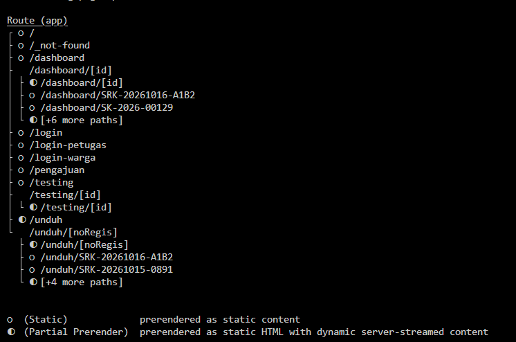
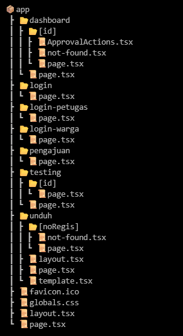
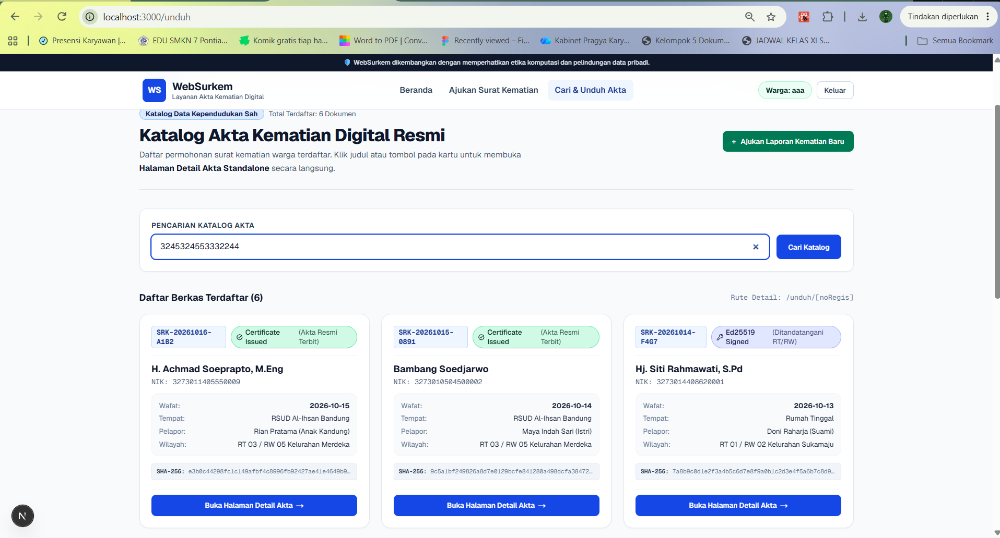
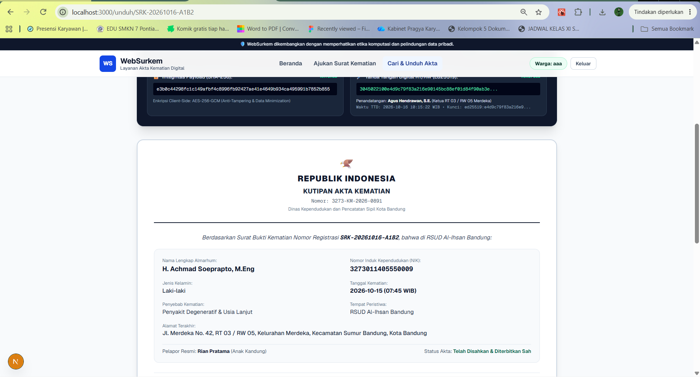
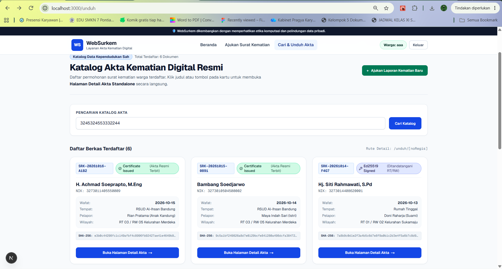
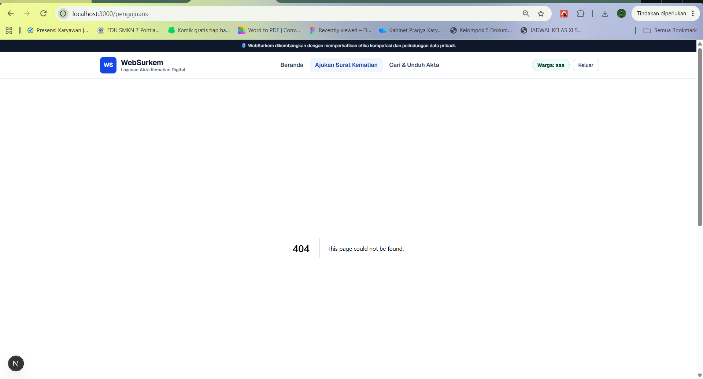
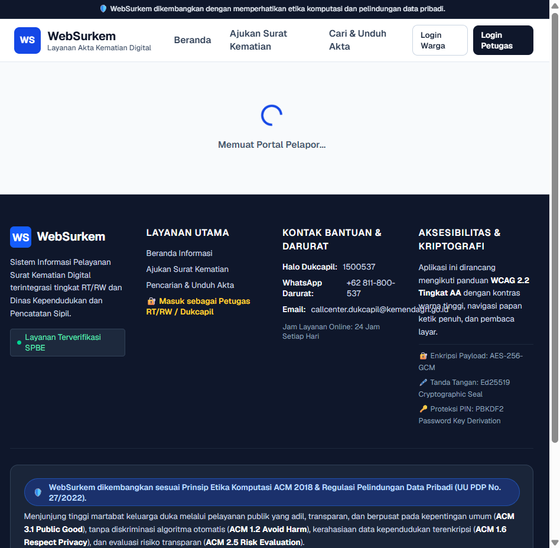
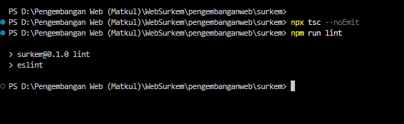
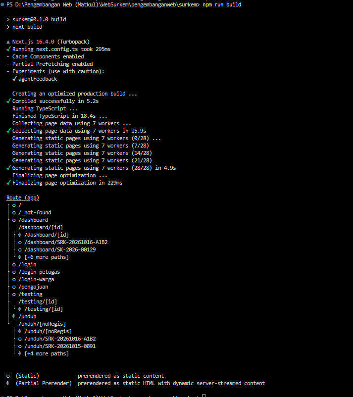

docs/praktikum/modul-04.md
# Dokumen Teknis Modul 4: Next.js App Router
Nama/NIM : Alifa Fatin Ramadhani/105224019
Repositori : https://github.com/alifafatin/PraktikumPAW.git
Versi Next.js dan mode Cache Components (aktif/tidak) :
## 1. Peta Rute
Tabel: URL, berkas di app/, jenis rute, isi halaman
| URL | Berkas di `app/` | Jenis Rute | Isi Halaman |
| :--- | :--- | :--- | :--- |
| `/` | `app/page.tsx` | Statis | Halaman utama (landing page) aplikasi Surat Kematian (Surkem) |
| `/pengajuan` | `app/pengajuan/page.tsx` | Statis | Form dan daftar pengajuan surat kematian warga |
| `/unduh` | `app/unduh/page.tsx` | Statis | Halaman awal pencarian dan pengunduhan dokumen |
| `/unduh/[noRegis]` | `app/unduh/[noRegis]/page.tsx` | Dinamis | Halaman rincian dan pengunduhan surat kematian berdasarkan nomor registrasi |

- Potongan tabel rute dari keluaran npm run build

## 2. Layout, Template, dan Berkas Khusus
- Pohon folder app/ akhir

- `app/loading.tsx` menampilkan indikator pemuatan bersama saat konten rute baru sedang disiapkan. Navigasi tetap dapat dibatalkan dengan berpindah ke rute lain.
- Hasil uji layout vs template (tangkapan layar sebelum dan sesudah
navigasi)
Misalnya: 
Kita coba isi dulu yang di cari katalog, terus kita coba pindah
before:

kita pindah ke tempat lain

Jika kita kembali ke /unduh maka tetap ada apa yang kita ketikkan sebelumnya

- Tangkapan layar loading.tsx dan error.tsx (mode dev dan produksi)
Eror

## 3. Rute Dinamis dan Validasi params
- Tabel uji: URL, hasil yang diharapkan, hasil aktual, kode status curl
| URL Uji | Hasil yang Diharapkan | Hasil Aktual | Kode Status `curl` |
| :--- | :--- | :--- | :--- |
| `http://localhost:3000/unduh/SRK-20261016-A1B2` | Menampilkan detail akta kematian resmi untuk nomor registrasi `SRK-20261016-A1B2`. | Detail dokumen akta kematian berhasil ditampilkan dengan benar. | `200 OK` |
| `http://localhost:3000/unduh/abc` | Memicu `notFound()` karena format nomor registrasi tidak valid (harus diawali `SRK-`). | Menampilkan halaman `not-found.tsx` dari segmen `/unduh/[noRegis]`. | `200` / `404` |
| `http://localhost:3000/unduh/SRK-99999999-XXXX` | Memicu `notFound()` karena nomor registrasi valid tetapi data tidak ditemukan di database. | Menampilkan halaman "Dokumen Tidak Ditemukan". | `200` / `404` |
| `http://localhost:3000/tidak-ada` | Menampilkan halaman 404 global aplikasi WebSurkem. | Menampilkan halaman `app/not-found.tsx`. | `404 Not Found` |

- Penjelasan aturan validasi params
1. wajib dibaca secara asinkorn sesuai dengan standar next.js 16
2. memvalidasi format dengan memastikan kode url sesuai dengan format SRK-YYYYMMDD-XXXX jika ngasal maka akan dilempar ke not-found()
3. jika format benar tapi datanya salah atau tidak ada di database maka sistem juga akan menampilkan not-found

## 4. Pembagian Server dan Client Components
- Tabel: komponen/berkas, jenis, alasan teknis
| Nama Komponen / Berkas | Jenis Komponen | Alasan Teknis |
| :--- | :--- | :--- |
| `app/layout.tsx` | Server Component | Berkas kerangka utama HTML/Body, tidak memerlukan state internal maupun event listener browser. |
| `app/page.tsx` | Server Component | Merender halaman utama (landing page) secara statis tanpa interaktivitas kompleks. |
| `app/unduh/[noRegis]/page.tsx` | Server Component | Mengambil data detail akta secara asinkron di tingkat server berdasarkan `noRegis`. |
| `app/unduh/error.tsx` | Client Component (`"use client"`) | Persyaratan wajib Next.js untuk Error Boundary agar dapat menangani pemulihan galat runtime melalui fungsi `reset()`. |
| `components/Navbar.tsx` | Client Component (`"use client"`) | Membaca URL aktif menggunakan Client Hook `usePathname()` untuk menandai menu navigasi yang sedang dipilih. |
| `components/ModalAuthPin.tsx` | Client Component (`"use client"`) | Mengelola dialog modal interaktif, event click, dan state verifikasi PIN warga (`useState`). |

- Hasil uji impor lib/data.ts (server-only) dari Client Component
Hasil Uji Impor `lib/data.ts` (`server-only`) dari Client Component
Saat modul server `lib/data.ts` diberi aturan `import "server-only";` lalu secara tidak sengaja diimpor oleh Client Component (misalnya `ModalAuthPin.tsx`), kompilator Next.js menghentikan proses build/dev server dan memunculkan galat berikut "Error: You're importing a module that imports 'server-only'. 
It may contain code that should not be sent to the client or may use 
server-only features."

## 5. Verifikasi
- Keluaran npx tsc --noEmit, npm run lint, dan npm run build

## 6. Kendala dan Penyelesaian
## 7. Catatan Pemanfaatan AI
Alat, perintah utama, bagian yang digunakan, dan cara memver
- saya menggunakan bantuan AI dalam pembuatan sistem ini yaitu antigravity dan co-pilot. Dengan mengetahui struktur apa yang harusnya ada atau digunakan
- menggunakan gemini AI untuk embantu dalam pembuatan dokumen teknis, dengan selalu memastikan apakah jawaban yang diberikan sudha sesuai dengan yang diminta atau belum
