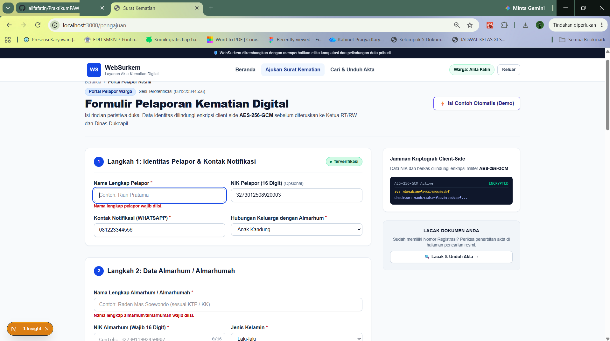
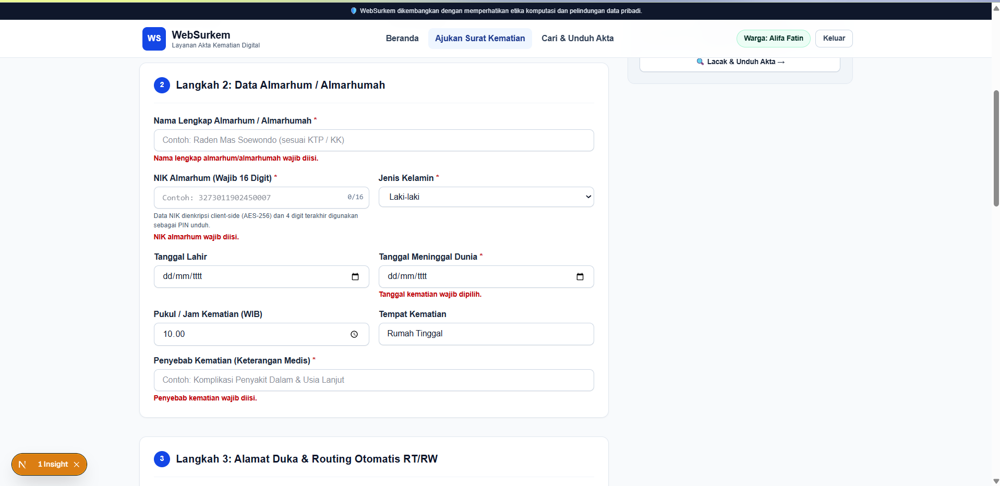
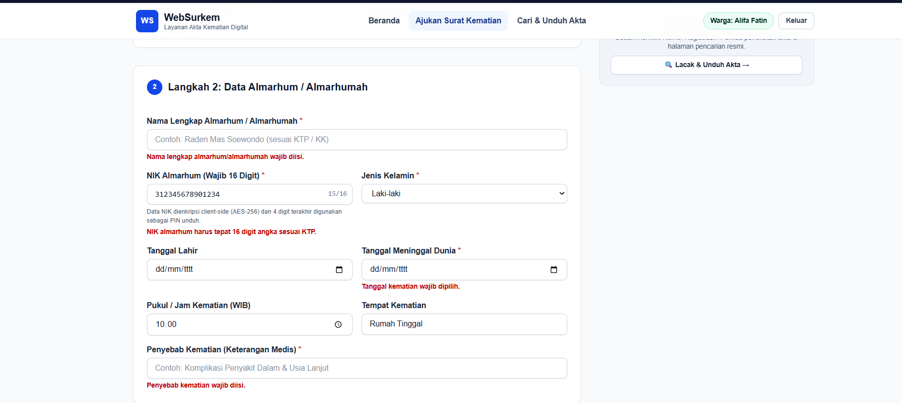
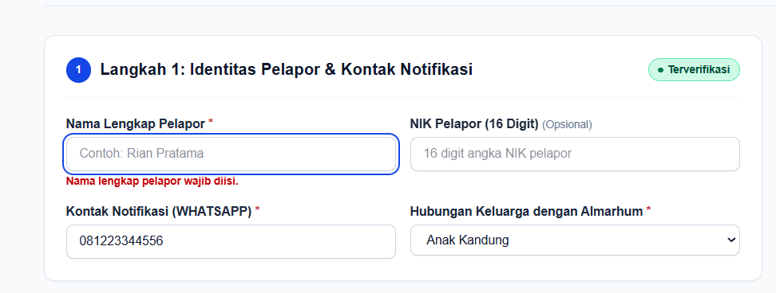

docs/praktikum/modul-05.md
# Dokumen Teknis Modul 5 — Formulir, Validasi, Session, dan Cookie
Nama/NIM : Alifa Fatin / 105224019
Repositori : https://github.com/alifafatin/PraktikumPAW.git
## 1. Skema Validasi

Validasi formulir pengajuan berada di `lib/schemas/death-report.ts` menggunakan Zod. Fungsi `validateForm` pada `app/pengajuan/page.tsx` menjalankan `safeParse` di browser dan menampilkan galat pada kolom terkait.

| Kolom | Aturan Zod | Pesan galat |
|---|---|---|
| Nama pelapor (`reporterName`) | String, spasi di awal/akhir dipangkas, wajib berisi minimal satu karakter | Nama lengkap pelapor wajib diisi. |
| Nama almarhum (`deceasedName`) | String, spasi di awal/akhir dipangkas, wajib berisi minimal satu karakter | Nama lengkap almarhum/almarhumah wajib diisi. |
| NIK almarhum (`deceasedNik`) | String wajib; harus tepat 16 digit angka | NIK almarhum wajib diisi; jika format salah: NIK almarhum harus tepat 16 digit angka sesuai KTP. |
| NIK pelapor (`reporterNik`) | Opsional; bila diisi harus tepat 16 digit angka | NIK pelapor harus tepat 16 digit angka. |
| Tanggal kematian (`dateOfDeath`) | String wajib tidak kosong | Tanggal kematian wajib dipilih. |
| Penyebab kematian (`causeOfDeath`) | String, spasi di awal/akhir dipangkas, wajib berisi minimal satu karakter | Penyebab kematian wajib diisi. |
| Alamat (`address`) | String, spasi di awal/akhir dipangkas, wajib berisi minimal satu karakter | Alamat duka wajib diisi. |
| Persetujuan (`consent`) | Boolean harus bernilai `true` | Anda wajib menyetujui deklarasi persetujuan pemrosesan data kependudukan (UU PDP No. 27/2022) sebelum mengirimkan laporan. |

Validasi format kontak menggunakan `superRefine`: email harus memiliki format dasar `nama@domain.tld`; nomor WhatsApp harus berisi 8–15 digit setelah karakter selain angka dihapus. Pesan galatnya masing-masing adalah “Masukkan alamat email yang valid.” dan “Nomor WhatsApp harus terdiri dari 8–15 digit.”

### Validasi semantik

Validasi berikut perlu dilakukan di server sebelum laporan disimpan karena pemeriksaan di browser dapat dilewati:

- Pastikan tanggal kematian merupakan tanggal yang valid dan tidak berada di masa depan.
- Jika tanggal lahir diisi, pastikan tanggal lahir lebih awal daripada tanggal kematian.
- Pastikan pengguna memiliki sesi dan berhak mengirim pengajuan; identitas dan peran tidak boleh dipercaya hanya dari data formulir.
- Pastikan RT/RW tujuan sesuai dengan wilayah atau aturan penugasan yang berlaku.
- Jika dokumen pendukung diwajibkan, periksa berkas yang benar-benar diterima, bukan hanya nama berkas atau status tampilan di browser.

Aturan semantik tersebut belum dijalankan oleh Server Action pada implementasi saat ini. Skema Zod yang ada juga belum memeriksa kewajaran tanggal, hubungan tanggal lahir-kematian, atau otorisasi pengguna.

## 2. Alur Server Action

### Alur pada implementasi saat ini

1. Pengguna mengisi formulir pada `app/pengajuan/page.tsx`.
2. Formulir menggunakan atribut `noValidate`, sehingga validasi bawaan browser dilewati.
3. Saat submit, `handleSubmit` menjalankan `validateForm`, lalu Zod `safeParse` di sisi klien.
4. Jika data tidak valid, galat disimpan di state React, ditampilkan di bawah kolom terkait, dan kolom pertama yang tidak valid difokuskan.
5. Jika data valid, aplikasi membuat objek laporan di browser setelah simulasi `setTimeout`, lalu memanggil `addReport` dari `lib/mockData.ts`.
6. Aplikasi menampilkan tanda terima. Belum ada penyimpanan server, Server Action, `revalidatePath`, atau `redirect` untuk pengajuan.

### Rancangan alur Server Action

Jika alur ini dikembangkan menjadi Server Action, urutannya adalah: validasi sesi di server → validasi bentuk dengan Zod → validasi semantik dan otorisasi → mutasi data melalui penyimpanan server → `revalidatePath` untuk halaman yang terdampak → `redirect` ke halaman tanda terima/status. Validasi klien tetap berguna untuk pengalaman pengguna, tetapi hasilnya tidak menggantikan pemeriksaan server.

### Pembagian berkas

- **Saat ini:** `app/pengajuan/page.tsx` merupakan Client Component (memiliki `'use client'`) yang menggabungkan tampilan, state formulir, validasi klien, dan simulasi mutasi. `lib/schemas/death-report.ts` berisi skema Zod yang digunakan oleh komponen tersebut.
- **Belum tersedia:** Server Component khusus untuk memuat data/sesi pengajuan dan berkas Server Action (`'use server'`) untuk memvalidasi serta menyimpan pengajuan belum terlihat pada implementasi ini.
- **Rancangan:** pisahkan tampilan interaktif formulir sebagai Client Component; muat data dan sesi yang dibutuhkan melalui Server Component; tempatkan mutasi dan otorisasi dalam Server Action atau lapisan server yang dipanggilnya.

## 3. Bukti Uji Validasi

Formulir memakai `noValidate`, jadi validasi bawaan browser tidak dijalankan saat submit. Namun, handler tetap memanggil validasi Zod di klien. Tabel berikut merangkum perilaku yang dapat dipastikan dari kode; pengujian manual dan tangkapan layar belum dilakukan.

| No. | Masukan/kasus uji | Hasil yang diharapkan | Hasil aktual saat ini | Bukti |
|---|---|---|---|---|
| 1 | Nama pelapor dikosongkan, lalu submit | Submit ditolak dan galat nama pelapor tampil | Berdasarkan kode, Zod menolak dan galat ditampilkan; belum diuji manual |  |
| 2 | Nama almarhum dikosongkan, lalu submit | Submit ditolak dan galat nama almarhum tampil | Berdasarkan kode, Zod menolak dan galat ditampilkan; belum diuji manual | |
| 3 | NIK almarhum dikosongkan, lalu submit | Submit ditolak sebagai kolom wajib | Berdasarkan kode, Zod menolak; belum diuji manual | |
| 4 | NIK almarhum diisi 15 digit | Submit ditolak dengan galat format NIK | Berdasarkan kode, Zod menolak; belum diuji manual | |
| 5 | NIK pelapor dikosongkan | Boleh dilanjutkan karena opsional | Berdasarkan kode, Zod menerima nilai kosong; belum diuji manual | |

## 4. Session dan Cookie

### Kondisi aplikasi saat ini

Login warga dan petugas saat ini menyimpan data sesi di `localStorage` dengan key `websurkem_user_session` melalui `lib/mockData.ts`. Aplikasi belum membuat cookie sesi atau mengelola sesi di server. Karena itu, belum ada atribut cookie maupun header `Set-Cookie` dari sesi aplikasi yang bisa diperiksa.

### Atribut cookie yang direncanakan

Jika sesi server diterapkan, browser hanya menyimpan ID sesi acak. Data sesi dan peran pengguna disimpan serta diverifikasi di server.

| Atribut | Nilai yang direncanakan | Alasan |
|---|---|---|
| `HttpOnly` | Aktif | Mencegah JavaScript membaca ID sesi secara langsung. |
| `Secure` | Aktif di produksi | Cookie hanya dikirim melalui HTTPS. Untuk pengembangan lokal, pengaturan disesuaikan dengan protokol yang digunakan. |
| `SameSite` | `Lax` | Membatasi pengiriman cookie pada sebagian permintaan lintas situs sambil mendukung navigasi biasa. |
| `Path` | `/` | Cookie berlaku untuk seluruh rute aplikasi. |
| `Max-Age` | 28.800 detik (8 jam), rancangan awal | Membatasi masa berlaku sesi; durasi final mengikuti kebijakan aplikasi. |
| `Domain` | Tidak ditetapkan | Membatasi cookie ke host aplikasi, kecuali ada kebutuhan berbagi antar-subdomain. |

### Tangkapan layar dan hasil uji

- **Panel Application dan header `Set-Cookie`:** belum tersedia karena aplikasi belum mengirim cookie sesi. Setelah fitur diterapkan, bukti diambil dari DevTools → Application → Cookies dan Network → Response Headers. Nilai cookie harus disamarkan.
- **Cookie palsu:** belum dapat diuji karena belum ada sesi server yang memvalidasi cookie.
- **Logout:** saat ini logout menghapus sesi dari `localStorage`; belum ada cookie sesi atau data sesi server untuk dicabut.
- **Cookie lama setelah logout:** belum dapat diuji. Pada implementasi sesi server, logout harus membatalkan sesi di server sehingga ID sesi lama ditolak meskipun dikirim kembali.

| Kasus uji | Hasil yang diharapkan | Hasil aktual saat ini |
|---|---|---|
| Mengirim cookie sesi palsu | Server menolak sesi dan tidak memberi akses ke halaman/data terlindungi | Belum dapat diuji; cookie sesi server belum diterapkan |
| Logout | Cookie dihapus dan sesi server dibatalkan | Yang tersedia hanya penghapusan sesi `localStorage` |
| Mengirim ulang cookie lama setelah logout | Server menolak ID sesi yang sudah dibatalkan | Belum dapat diuji; sesi server belum diterapkan |

## 5. Keputusan Teknis

### Session di server dibanding token di cookie

Untuk WebSurkem, sesi server lebih sesuai karena status sesi dapat diperiksa dan dicabut ketika pengguna logout atau sesi tidak lagi valid. Cookie cukup berisi ID sesi acak, sedangkan informasi pengguna dan perannya tetap dikelola di server. Dengan demikian, browser tidak menjadi sumber kebenaran untuk identitas maupun hak akses.

Token di dalam cookie juga harus diverifikasi dan dilindungi dengan atribut cookie yang sesuai. Namun, pencabutan token sebelum masa berlakunya habis dapat memerlukan mekanisme tambahan. Karena itu, rancangan yang disarankan adalah cookie berisi ID sesi acak yang terhubung ke sesi di server. Ini merupakan keputusan rancangan; aplikasi saat ini masih menggunakan `localStorage`, bukan sesi server.

### Batas peran `proxy.ts` dan pemeriksaan di aksi

`proxy.ts` dapat melakukan pemeriksaan awal dan pengarahan, misalnya mengirim pengguna yang tidak memiliki sesi ke halaman login. Proxy bukan pengganti otorisasi pada operasi yang membaca atau mengubah data.

Setiap Server Action atau lapisan akses data harus memvalidasi sesi di server serta memastikan peran pengguna berhak melakukan operasi tersebut. Pemeriksaan ini tetap diperlukan karena aksi dapat dipanggil langsung tanpa melalui alur halaman atau pemeriksaan proxy. Proyek saat ini belum memiliki `proxy.ts` maupun Server Action untuk sesi dan pengajuan; uraian ini adalah rancangan, bukan fitur yang sudah aktif.
## 6. Kendala dan Penyelesaian
## 7. Catatan Pemanfaatan AI
AI pada kali ini digunakan untuk membantu mengerjakan nomor 4 dan 5 karena hal yang diminta belum dibuat, serta pembuatan web yang menggunakan bantuan AI, dan juga membantu dalam pembuatan file md ini