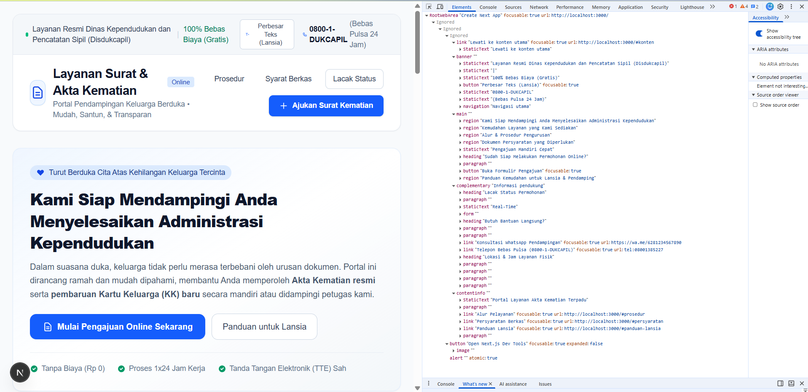
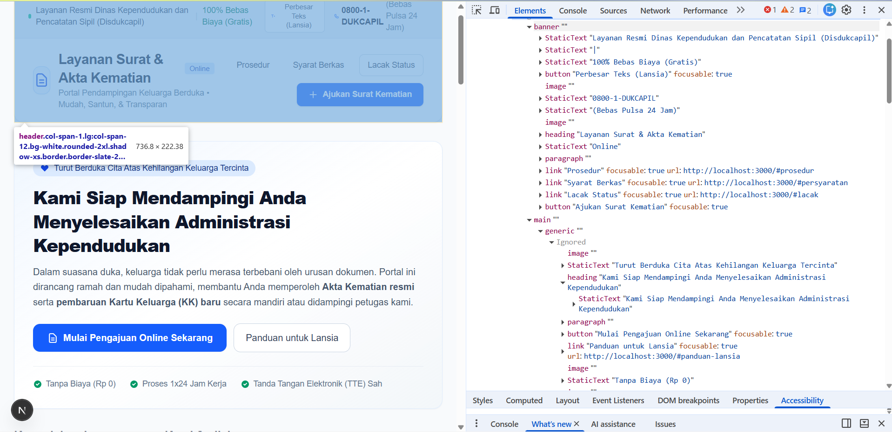
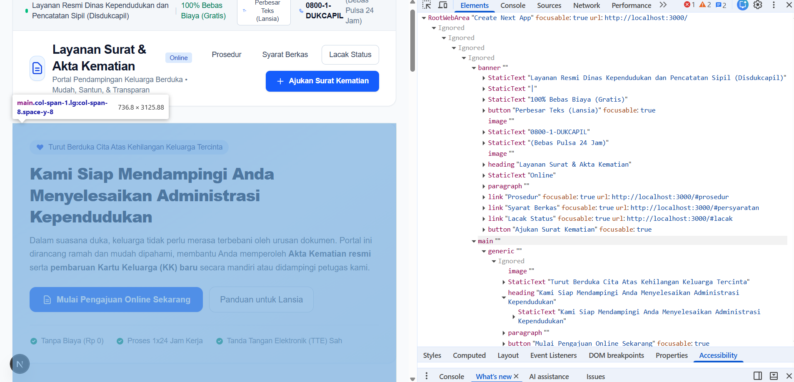
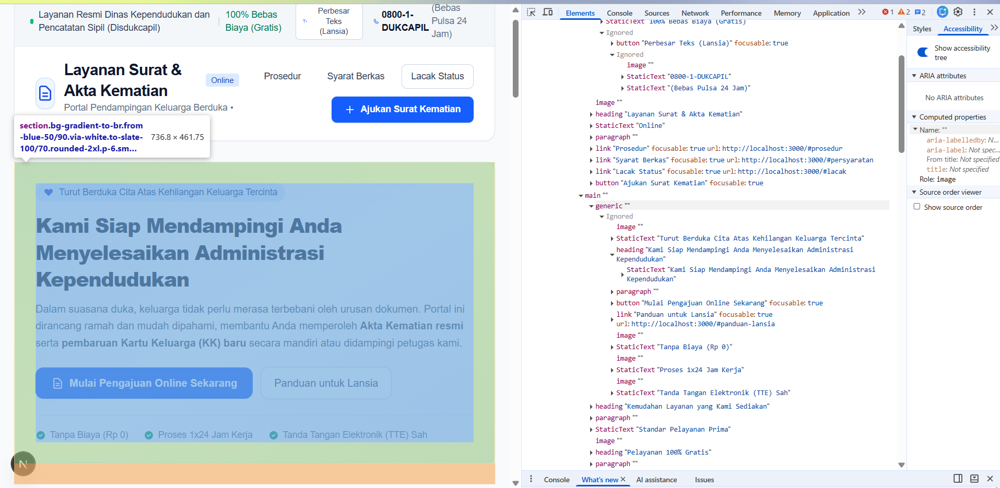
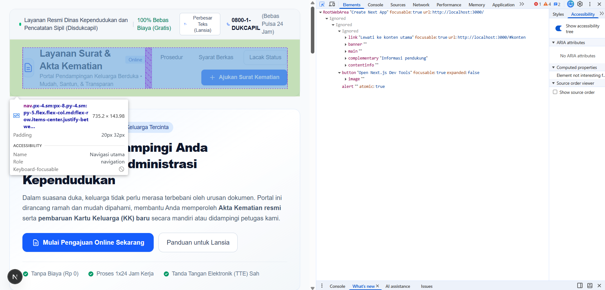
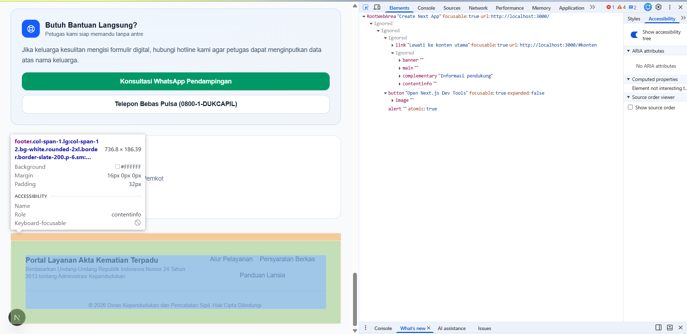
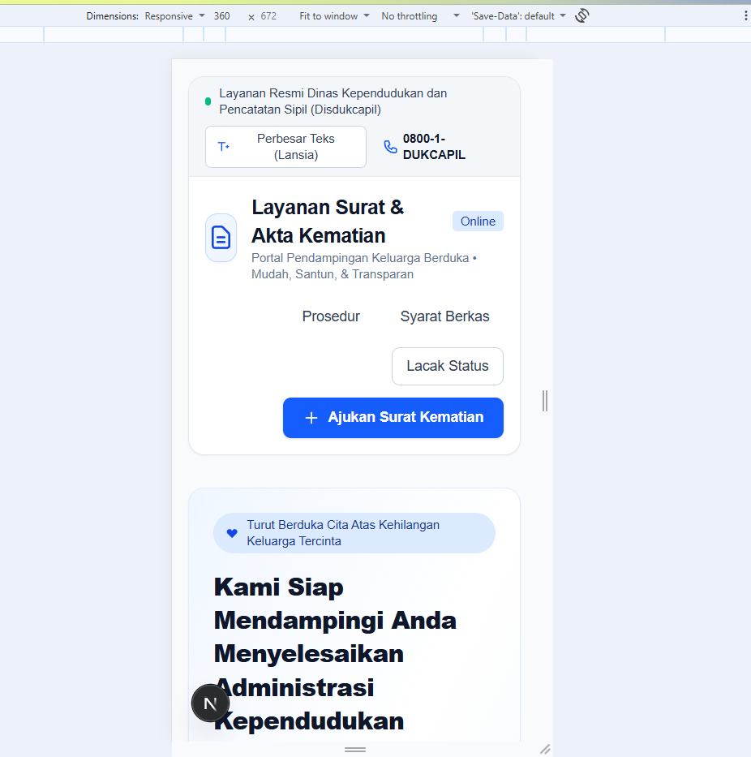
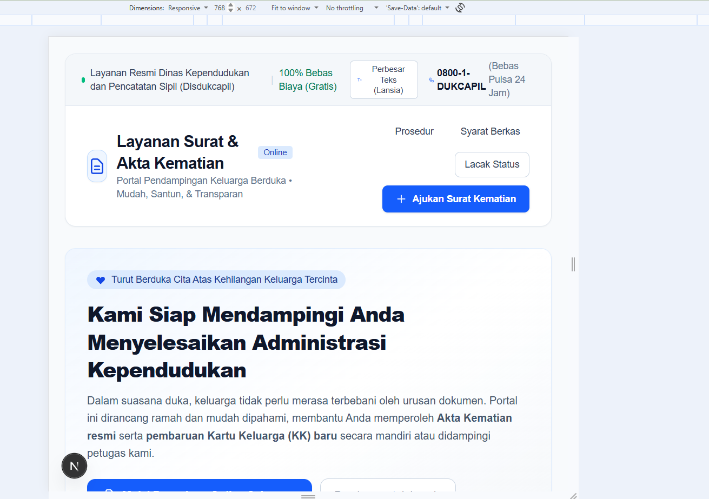
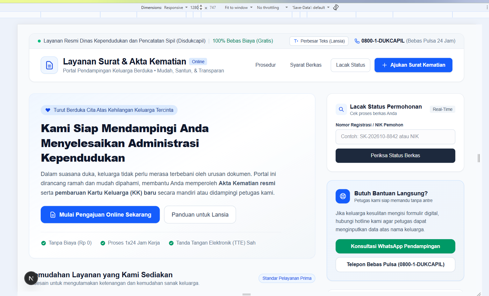

# Dokumen Teknis Modul 2 — HTML Semantik, Tailwind CSS, dan Aksesibilitas
Nama/NIM : Alifa Fatin Ramadhani - 105224019
Repositori : https://github.com/alifafatin/PraktikumPAW.git

## 1. Struktur Semantik
- Kerangka landmark dan hierarki judul halaman utama

- Tangkapan layar pohon aksesibilitas pada DevTools

## 2. Tata Letak Responsif
- Tangkapan layar pada lebar 360 px, 768 px, dan 1280 px

- Kelas Flexbox, Grid, dan breakpoint yang digunakan beserta alasannya
> grid grid-cols-1 lg:grid-cols-12 gap-8 -> figunakan untuk mengimplementasikan 12 kolom grid layout sesuai standar, pada layar desktop. Area dibagi mennadi delapan kolom untuk konten utama dan 4 kolom untuk sidebar. Pada layar mobile, grid menjadi 1 kolom tunggal
> flex flex-col sm:flex-row items-center justify-between -> digunakan untuk memungkinkan pemisahan elemen kiri dan kanan secara dinamis, pada layar mobile arah flex akan berubah menjadi vertikal agar elemen menumpuk dengan rapi
>breakpoint (sm, md, dan lg) -> digunakan untuk transisi dari tata letak satu kolom ke dua kolom pada formulir, modal, dan grid kartu serrta mengubah arah flex dari vertikal ke horizontal. Digunakan juga untuk menyembunyikan atau menampilkan teks pendukung guna menjga kepadatan visual pada navigasi. Dan mengaktifkan sidebar 2/3 dan 1/3 pada area main

## 3. Audit Aksesibilitas
- Tabel skor Lighthouse sebelum dan sesudah perbaikan
 (halaman latihan dan halaman utama)
| Halaman   | Sebelum Perbaikan | Sesudah perbaikan | Peningkatan |
-------------------------------------------------------------------
|Halaman    | 82 / 100          | 98/100            | 16pt        |
|Utama      |                   |                   |             |
-------------------------------------------------------------------
|Formulir   | 74 / 100          | 96/100            | 22pt        |
|Modal      |                   |                   |             |
-------------------------------------------------------------------
- Daftar audit yang gagal, penyebab, dan perbaikannya
> Masalah kotak centang, pada dokumen, elemen checkbox dieender dan disalam div dibungkus tanpa label yang terhubung langsung sehingga screen membaca kotak tanpa konteks, perbaikannya ditambah, aria-label="Centang [Nama Dokumen]" pada setiap elemen <input>. Wrapper 
 menggunakan atribut role="checkbox" dan aria-checked jika diubah menjadi elemen kustom, atau membiarkan <input> menangani status fokus papan ketik secara native.
> masalah terhadap elemen skip limk, dimana tautan #konten sudah ada namun tak punya atribut target ID, perlu dipastikan mempunyai fokus yang sesuai ketika diakses melalui papan ketik, dengan memastikan bahwa terdapat id konten, maka nantinya akan siap menerima fokus langsung setelah skip
- Hasil pemeriksaan manual dengan papan ketik
> Skip navigation -> lulus -> alasan: skip link muncul ketika menekan tombol lewati ke konten utama
> Saat menekan tombol X di formulir -> lulus -> alasan: ketika ingin mengetik formulir pengajuan surat kematian, namun batal bisa langsung menekan tombol (X) dan akan kembali ke halaman utama

## 4. Kendala dan Penyelesaian
- 
## 5. Catatan Pemanfaatan AI
Alat, perintah utama, bagian yang digunakan, dan cara memverifikasinya.
Tulis "Tidak menggunakan AI" apabila tidak menggunakan AI.
Prompting: 
You are a frontend developer. Create a simple and empathetic interface for page.tsx in Next.js using Tailwind CSS.

The rules:
1. The website is an online portal for Death Certificate Application and Information Services (Layanan Surat Kematian) designed to assist grieving families easily.
2. Design Layout Requirements based on specific CSS specifications:
   - Use CSS Grid layout for the main page structure: header (col-span-2), main content area, sidebar (aside), and footer (col-span-2).
   - Implement a mobile-first responsive grid approach for section contents (e.g., features, steps, or required documents cards): `grid grid-cols-1 sm:grid-cols-2 lg:grid-cols-3`.
   - Use Flexbox for one-dimensional items (like navbar, badge tags, or action buttons) utilizing `justify-*` and `items-*` for proper alignment.
3. The homepage must be very clear, clean, and simple for elderly or non-tech-savvy users, using reassuring and soft colors (e.g., slate, blue, or warm muted tones).
4. Include details about death certificate procedures, required documents, and an easy online submission form trigger.

The output needs to be a single code file (page.tsx) after finished.

Digunakan untuk membantu dalam pembuatan website atau tampilan halaman 
