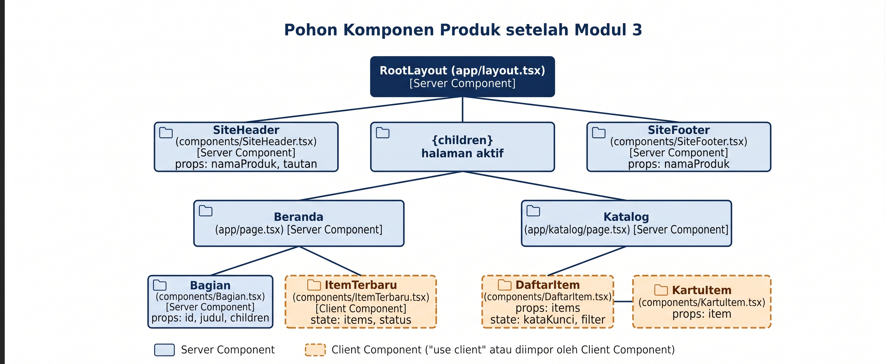
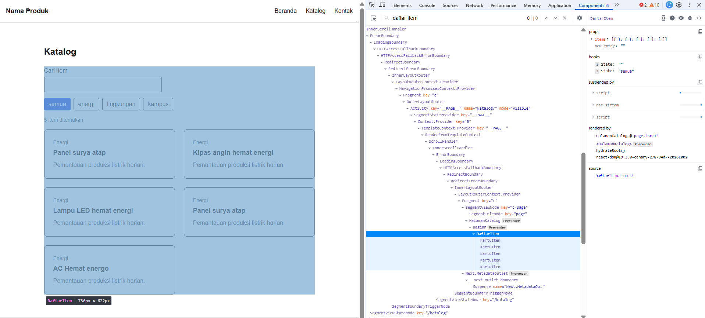
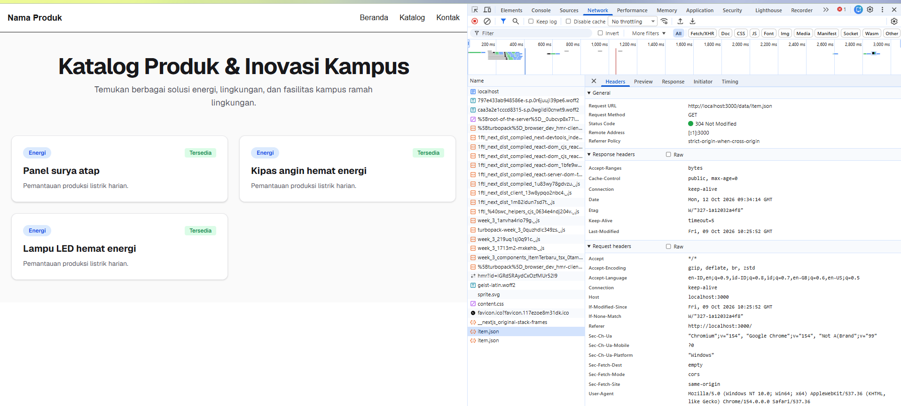
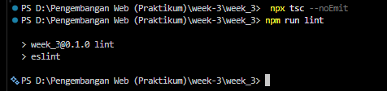

# Dokumen Teknis Modul 3 — TypeScript dan Komponen React
Nama/NIM : ALifa Fatin/105224019
Repositori : https://github.com/alifafatin/PraktikumPAW.git (Branch modul-03)
## 1. Tipe Data Produk
- Isi lib/tipe.ts dan alasan pemilihan union type serta properti opsional

 Jawaban:
 export type Kategori = "energi" | "lingkungan" | "kampus";
 
export interface Item {
  id: number;
  judul: string;
  kategori: Kategori;
  deskripsi: string;
  tersedia: boolean;
  gambar?: string;
}

Alasan:
1. Union type(kategori), digunakan untuk membatasi nilai kategori hanya pada string tertentu ("energi" | "lingkungan" | "kampus"), sehingga mencegah kesalahan ketik atau typo sata pengisian data
2. Properti opsional (gambar?: string), tanda ? menandakan bahwa properti gambar tidak wajib ada pada setiap item produk, mengantisipasi kondisi di mana beberapa item mempunyai tautan atau lampiran gambar

## 2. Struktur Komponen
- Diagram pohon komponen akhir (Server dan Client Component)

- Tabel komponen: nama, props dan tipenya, tempat digunakan
### Tabel Komponen
| Nama Komponen | Lokasi Berkas | Props & Tipe Data | Jenis Component | Tempat Digunakan |
| :--- | :--- | :--- | :--- | :--- |
| **SiteHeader** | `components/SiteHeader.tsx` | • `namaProduk: string` • `tautan: Tautan[]` *(di mana `Tautan = { href: string; label: string }`)* | Server Component | `app/layout.tsx` (di dalam `RootLayout`) |
| **SiteFooter** | `components/SiteFooter.tsx` | • `namaProduk: string` | Server Component | `app/layout.tsx` (di dalam `RootLayout`) |
| **Bagian** | `components/Bagian.tsx` | • `id: string` • `judul: string` • `children: React.ReactNode` | Server Component | • `app/page.tsx` (`Beranda`) • `app/katalog/page.tsx` (`Katalog`)|
| **ItemTerbaru** | `components/ItemTerbaru.tsx` | *(Tidak menerima props)* | Client Component (`"use client"`) | `app/page.tsx` (di dalam komponen `Bagian` pada halaman Beranda)|
| **DaftarItem** | `components/DaftarItem.tsx` | • `items: Item[]` | Client Component (`"use client"`) | `app/katalog/page.tsx` (di dalam komponen `Bagian` pada halaman Katalog) |
| **KartuItem** | `components/KartuItem.tsx` | • `item: Item` | Diimpor oleh Client Component | `components/DaftarItem.tsx` (di-render secara berulang menggunakan `.map()`) |

## 3. State dan Interaksi
- Tangkapan layar tab Components (props dan state DaftarItem)

- Penjelasan alur dari event hingga render ulang
1. **Inisialisasi State:** Komponen `DaftarItem` menginisialisasi dua state utama via hook `useState`, yaitu `kataKunci` (string kosong `""`) dan `filter` (bernilai awal `"semua"`)
2. **Pemicu Event (Triggering Event):** Saat pengguna memasukkan teks pada kolom *"Cari item"* (`onChange`) atau memilih salah satu tombol kategori filter (`onClick`), fungsi handler akan dipanggil
3. **Pengubahan State (State Update):** Handler memanggil `setKatakunci` atau `setFilter` yang memperbarui nilai state pada React
4. **Hitung Ulang & Render Ulang (Re-render):** Perubahan state memicu React untuk meng-render ulang `DaftarItem`. Variabel turunan `hasil` dihitung ulang secara dinamis untuk menyaring daftar `items` berdasarkan `kataKunci` dan `filter` terbaru
5. **Pembaruan Tampilan (UI Render):** Komponen anak `KartuItem` di-render ulang sesuai dengan daftar item yang telah disaring

## 4. Pengambilan Data
- Tangkapan layar panel Network untuk permintaan item.json

- Hasil pengujian kondisi memuat, berhasil, dan gagal
1. **Kondisi Memuat (`memuat`):**
   * **Pengujian:** Mengaktifkan opsi throttling **"Slow 4G"** pada tab Network di DevTools, lalu memuat ulang (*refresh*) halaman.
   * **Hasil:** Teks indikator `"Memuat data..."` muncul secara sementara sebelum data selesai diunduh dari `/data/item.json`.

2. **Kondisi Berhasil (`berhasil`):**
   * **Pengujian:** Memuat halaman dalam kondisi jaringan normal.
   * **Hasil:** Permintaan HTTP GET ke `/data/item.json` berhasil dijalankan dan mengembalikan data produk. Tiga item terbaru berhasil dipotong (`slice(0, 3)`) dan ditampilkan pada grid halaman utama.

3. **Kondisi Gagal (`gagal`):**
   * **Pengujian:** Mengubah sementara jalur *fetch* pada berkas `components/ItemTerbaru.tsx` menjadi `/data/tidak-ada.json`.
   * **Hasil:** Server mengembalikan kode status error `404 Not Found`. Karena `res.ok` bernilai `false`, program menangkap eksepsi pada blok `catch` dan menampilkan pesan peringatan `"Data gagal dimuat. Muat ulang halaman."`.

## 5. Verifikasi
- Keluaran npx tsc --noEmit dan npm run lint

## 6. Kendala dan Penyelesaian
## 7. Catatan Pemanfaatan AI
Alat, perintah utama, bagian yang digunakan, dan cara memverifikasinya.
Tulis "Tidak menggunakan AI" apabila tidak menggunakan AI.

Alat: Gemini AI
prompt: bisakah anda membantu saya dalam pembuatan pohon komponen sesuai dengan folder yang saya kirimkan sebelumnya 